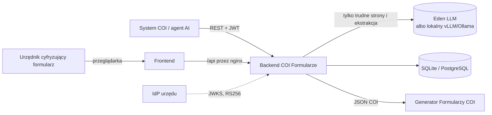
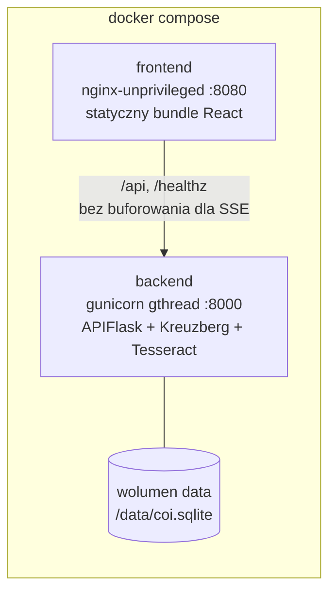
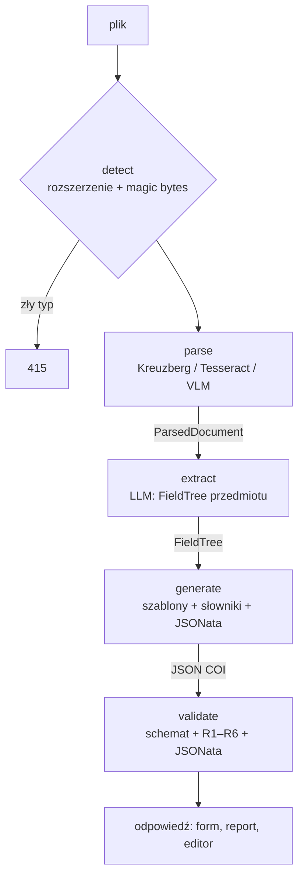
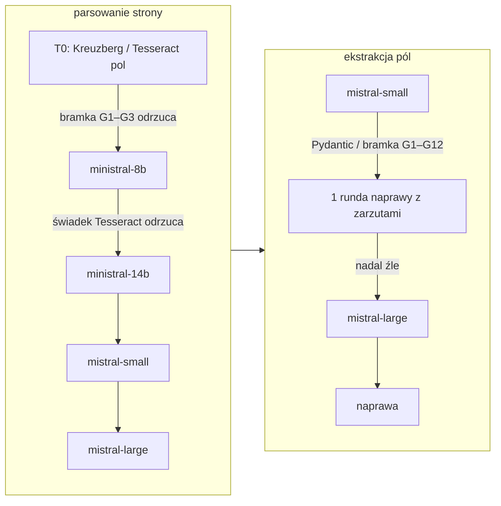

# Architektura

Dokument spełnia wymaganie M5 (dokumentacja architektury). Każda decyzja ma odnośnik do ADR-u, a stan wymagań jest w [compliance.md](compliance.md). Szczegóły modułów: [design/parser-contract.md](design/parser-contract.md), [design/field-extraction.md](design/field-extraction.md), [design/generator.md](design/generator.md), [dictionaries.md](dictionaries.md), [storage.md](storage.md).

## Kontekst

Użytkownicy to urzędnicy, którzy cyfryzują e-usługi, oraz w przyszłości agenci AI (AI HUB, Multiportal). Wejście: jeden plik blankietu. Wyjście: JSON zgodny ze schematem zadania i wzorcami #1 i #5, gotowy do importu.

## Kontenery

- Każdy moduł ma własny Dockerfile i działa jako osobny kontener ([ADR 0003](adr/0003-kontener-na-modul.md)), monorepo `app/` ([ADR 0001](adr/0001-monorepo-flask-vite-react.md)).
- Jedno publiczne API, bez kontenerów pomocniczych: parsowanie działa w procesie backendu ([ADR 0004](adr/0004-jedno-publiczne-api.md), [ADR 0009](adr/0009-parsowanie-konczy-sie-na-parseddocument.md)).
- Python 3.14, uv, tylko licencje bez copyleftu ([ADR 0002](adr/0002-python-314-uv-licencje.md)).

## Przepływ: `parse → extract → generate → validate`

Kod: `backend/coi/pipeline.py` (`convert()`), wołany przez `POST /api/v1/forms` ([ADR 0013](adr/0013-post-forms-synchronicznie.md)). Każdy krok wysyła zdarzenia `stage`, `escalation` i `warning` do strumienia SSE ([ADR 0014](adr/0014-postep-przez-sse.md)).

| Krok | Moduł | Wejście → wyjście | LLM |
|---|---|---|---|
| parse | `coi/parsing` | bajty → `ParsedDocument` (strony, bloki, `trace`) | tylko skany i strony, które bramka odrzuci |
| extract | `coi/extraction` | `ParsedDocument` → `FieldTree` (strony, sekcje, pola, `show_if`, zgody, usunięte bloki) | tak, z bramką i naprawą |
| generate | `coi/generator` | `FieldTree` → JSON COI (szablon „Dane”, przedmiot, „Kontakt i zgody”, koniec; słowniki; walidatory; `states`) | nie, deterministycznie |
| validate | `coi/generator/validate.py` | JSON COI → lista naruszeń | nie |

Generator jest deterministyczny i nie zna numeru formularza: reguły wynikają z treści ([ADR 0024](adr/0024-uniwersalne-reguly-bez-poprawek-pod-formularz.md)). Edytor może przebudować formularz z zapisanego `FieldTree` bez ponownego LLM (`/regenerate`, [ADR 0027](adr/0027-tylko-osobiscie-i-regeneracja.md)).

## Drabina eskalacji i bramki

Najtańszy krok idzie pierwszy. Kolejny szczebel startuje tylko wtedy, gdy kod (bramka) odrzuci wynik ([ADR 0008](adr/0008-drabina-eskalacji-z-bramka.md)).

- **Bramka parsowania** (`coi/parsing/gate.py`, progi w `ladder.json`): udział śmieci i nonsensu, polskie znaki, liczba znaczników `☐`/`___`, pewność OCR, pokrycie słów względem Tesseracta jako świadka ([ADR 0007](adr/0007-t0-lokalnie-skany-do-vlm.md)).
- **Bramka ekstrakcji** (`coi/extraction/gate.py`, bez wzorca): schemat Pydantic, istnienie kotwic, pokrycie każdego bloku z `___` lub `☐`, poprawność `show_if`, liczba opcji, ugruntowanie etykiet w źródle, powody usunięcia bloków, reguły z EVAL-3. Twarde błędy → naprawa, potem mocniejszy model; miękkie → `report.needs_review` z odnośnikiem do pola i bloku źródłowego ([design/field-extraction.md §6](design/field-extraction.md)).
- Długie i wielowariantowe dokumenty (> `EXTRACTION_TWO_STAGE_BLOCKS` bloków): najpierw szkielet stron, potem pola każdej strony równolegle.
- Timeout wywołania (`LLM_TIMEOUT_S`) to nieudany szczebel, a nie błąd żądania.

## Kontrakty

| Kontrakt | Gdzie | Opis |
|---|---|---|
| `ParsedDocument` | `coi/parsing/model.py` | `source`, `pages[{number, blocks[{kind, text, level, rows, bbox, confidence}]}]`, `warnings`, `trace`; znaczniki znormalizowane do `☐` i `___` ([design/parser-contract.md](design/parser-contract.md), [ADR 0005](adr/0005-mapa-parserow-i-parseddocument.md)) |
| `FieldTree` | `coi/extraction/tree.py` | Pydantic: `Addressee`, `SubjectPage` → `Section` → `FormField` (typ, etykieta, opcje, `show_if`, kotwica źródła), `Consent`, `Drop`. Wyjście LLM i wejście generatora ([design/field-extraction.md](design/field-extraction.md)) |
| JSON COI | `coi/form_schema.json` + `generator/templates/*.json` | `{title, tabs[], flow}`; strony `MAIN`, sekcje, pola z `validation`, `dictionaryName`, `defaultValue` (`MLPZ.*`), `states` SHOW z JSONata. Wzorce #1 i #5 mają pierwszeństwo przed schematem ([ADR 0023](adr/0023-wzorce-ponad-schemat.md)) |
| Raport | `pipeline.Result.report` | `trace`, `warnings`, `needs_review`, `proposed_dictionaries`, `validation`, `cost`, `seconds`, `source` |
| Edytor | `pipeline.Result.editor` | `source` (ParsedDocument), `field_map` (pole → strona, blok, bbox, needs_review), `tree`, propozycje |

Zasady treści JSON-a: pola domyślnie wymagane ([ADR 0018](adr/0018-pola-domyslnie-wymagane.md)), bez pól wyliczanych ([ADR 0019](adr/0019-bez-pol-wyliczanych.md)), #9 jako jeden formularz z radiem „rodzaj wniosku” ([ADR 0020](adr/0020-formularz-9-jeden-formularz.md)), wnioskodawca „tylko podmiot” ([ADR 0026](adr/0026-wnioskodawca-tylko-podmiot.md)). Scenariusze S1–S17 i role osób: [flow-scenarios.md](flow-scenarios.md).

## Słowniki i dane inicjalne

- Katalog w bazie: słowniki z materiałów (Kraje, TERYT, województwa, powiaty, gminy, miejscowości, numery kierunkowe; chronione), nasze propozycje i słowniki użytkownika. Dane offline w `coi/dictionaries/seed/`, bez sieci w runtime ([dictionaries.md](dictionaries.md)).
- Dopasowanie pola do słownika: punktacja etykiety i pokrycia opcji, próg `DICT_MATCH_THRESHOLD` ([ADR 0012](adr/0012-decyzja-o-slowniku-modelem-klasyfikacyjnym.md)).
- Nowy słownik: tylko gdy dokument albo katalog daje listę pozycji ([ADR 0021](adr/0021-nowy-slownik-tylko-z-lista-pozycji.md)); trafia do `report.proposed_dictionaries`, a JSON COI zawiera wyłącznie słowniki istniejące ([ADR 0025](adr/0025-propozycje-slownikow-tylko-w-raporcie.md)). Przyjęcie: `POST /api/v1/dictionaries/from-proposal`.
- Dane inicjalne: konfigurujemy źródło i atrybut (`defaultValue: "MLPZ.name"`), niczego nie wypełniamy ([ADR 0022](adr/0022-dane-inicjalne-tylko-konfiguracja.md)); źródło tożsamości `GENERATOR_PREFILL_IDENTITY`.

## Magazyn

SQLAlchemy 2, URL z `DATABASE_URL`; domyślnie SQLite na wolumenie, na produkcji PostgreSQL bez zmian w kodzie ([ADR 0017](adr/0017-sqlite-za-sqlalchemy.md), [storage.md](storage.md)). Tabele: `forms` (wynik, raport, dane edytora, sha256 i nazwa pliku, `created_by` z JWT) i słowniki. Przesłanego pliku nie zapisujemy. Migracji nie ma (`create_all` przy starcie).

## Bezpieczeństwo

| Obszar | Rozwiązanie | Dowód |
|---|---|---|
| Pliki | tylko w RAM (`InMemoryRequest`); render PDF i Tesseract w `TemporaryDirectory` usuwanym po żądaniu | `coi/__init__.py`, `coi/parsing/pipeline.py` |
| Walidacja wejścia | rozszerzenie + magic bytes, nazwa ≤ 250 znaków bez znaków zabronionych, `MAX_FILE_MB`, jeden plik | `coi/parsing/detect.py`, `coi/api.py`, `tests/api` |
| Uwierzytelnianie | JWT tylko weryfikowany: HS256 albo RS256 z JWKS, `iss`/`aud`/`exp` ([ADR 0015](adr/0015-jwt-tylko-weryfikacja.md)) | `coi/auth.py` |
| Sekrety | tylko w `app/.env` i zmiennych runtime, nigdy w obrazie ani logach ([ADR 0011](adr/0011-sekrety-tylko-w-env.md)) | `.gitignore`, `docker-compose.yml` (`env_file`) |
| Kontenery | przypięte wersje, użytkownik bez roota (`coi` uid 10001, `nginx` uid 101), po jednym porcie | Dockerfile'y |
| Sieć | CORS wyłączony, front i API pod jednym originem; air gap bez ruchu wychodzącego ([ADR 0010](adr/0010-adapter-dostawcy-modeli-i-air-gap.md)) | `frontend/nginx/`, `tests/parsing/test_airgap.py` |
| Logi | bez treści plików, nazw plików i tokenów | `coi/api.py` |

## Koszt na formularz

Z przebiegu E2E na docker compose ([results/README.md](../results/README.md), obraz z HEAD c935629):

| Formularz | Format | Czas [s] | Koszt [$] |
|---|---|---|---|
| #3 zaświadczenie (najprostszy) | docx | 4.6 | 0.0014 |
| #1, #5 (wzorce) | docx | 10–20 | 0.003–0.004 |
| #2, #4, #6, #7 | docx/doc | 19–69 | 0.004–0.017 |
| #8 deklaracja odpady (120 pól) | docx | 184.5 | 0.057 |
| #9 stypendium (151 pól, 3 wnioski w 1) | docx | 224.7 | 0.067 |
| #7 skan | jpg | 60.1 | 0.010 |
| #9 skan | png | 171.2 | 0.060 |

Cały przebieg 11 plików: **$0.25**, średnio około 2 centów na formularz. Pliki edytowalne nie wymagają VLM; koszt rośnie z liczbą pól i rundami naprawy. Przy `LLM_PROVIDER=local` koszt API wynosi zero (płaci się za GPU). Kontrolny przebieg #3 na HEAD 1d9ff53 (2026-11-22): 5.0 s, $0.0018.

## Dostosowanie bez zmiany kodu

| Co | Gdzie | Jak |
|---|---|---|
| Prompty | `backend/coi/prompts/*.md` | Kod tylko je wczytuje (`prompts.prompt(name, **values)`) i podstawia `{schema}`, `{text}`, `{base}`, `{errors}` itp. Wymagania urzędu (np. inne nazewnictwo, dodatkowe reguły pól) dopisuje się w treści `field_extraction.md`; nie usuwaj placeholderów w `{}`, a dosłowne nawiasy klamrowe zapisuj jako `{{ }}`. Zmiana wymaga restartu kontenera (albo przebudowy obrazu, bo prompty są w obrazie) |
| Prompt skanów | `prompts/vision_page.md` | instrukcja transkrypcji strony dla VLM |
| Drabina VLM i progi bramki skanów | `coi/parsing/ladder.json` (`ladder.local.json` dla air gap) albo własny plik przez `LADDER_PATH` | `tiers` (modele od najtańszego), `max_tokens`, `page_workers`, `gate.*` |
| Drabina ekstrakcji | `EXTRACTION_LADDER`, `EXTRACTION_MAX_TOKENS`, `EXTRACTION_TWO_STAGE_BLOCKS`, `EXTRACTION_WORKERS` | zmienne środowiskowe (`coi/config/extraction.py`) |
| Szablony stron | `coi/generator/templates/{dane,kontakt,finish,presets}.json` | strona „Dane”, „Kontakt i zgody”, koniec, presety pól (adres, osoba) |
| Słowniki | `/api/v1/dictionaries` albo seed `coi/dictionaries/seed/` | nowe słowniki bez wdrożenia |

Plik zamontowany jako wolumen (`-v ./moje-prompty:/app/coi/prompts:ro`) zmienia prompty bez przebudowy obrazu (po restarcie kontenera, bo prompty są cache’owane w procesie).

## Ograniczenia

- Synchroniczne żądanie: duże formularze trwają do 4 minut (gunicorn timeout 600 s). Brak kolejki zadań ([ADR 0013](adr/0013-post-forms-synchronicznie.md)).
- Dokumenty biurowe (docx, doc, ods, xlsx) nie mają obrazu strony (bez LibreOffice), więc nie eskalują do VLM: bramka daje tylko ostrzeżenie.
- `json_schema` w Eden nie jest wymuszany; jakość zależy od walidacji Pydantic i rundy naprawy.
- Schemat COI nie ma warunkowych przejść między stronami ani pól wyliczanych (flow liniowy, [ADR 0019](adr/0019-bez-pol-wyliczanych.md)).
- Brak migracji bazy; brak ról i uprawnień per użytkownik (każdy uwierzytelniony widzi wszystkie formularze).
- Jakość według oceny eksperckiej EVAL-3: wzorce #1 i #5 zgodne, błędy w formularzach z alternatywami, warunkami i osobami trzecimi (#8, #9) ([results/eval-3/README.md](../results/eval-3/README.md)); reguły G1–G17 z tej oceny wdrażane są po kolei.
- Token frontendu jest wbudowany w bundle (tylko demo).
