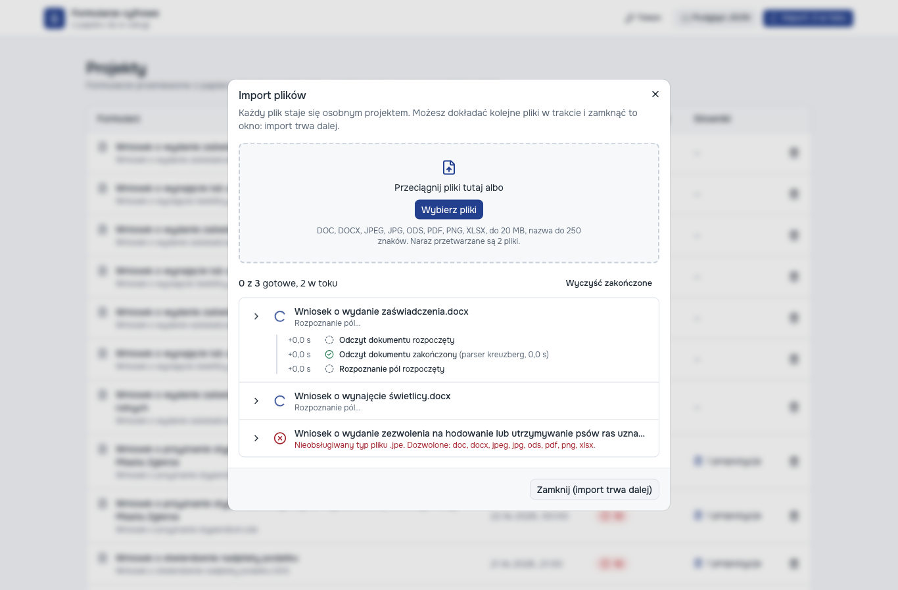
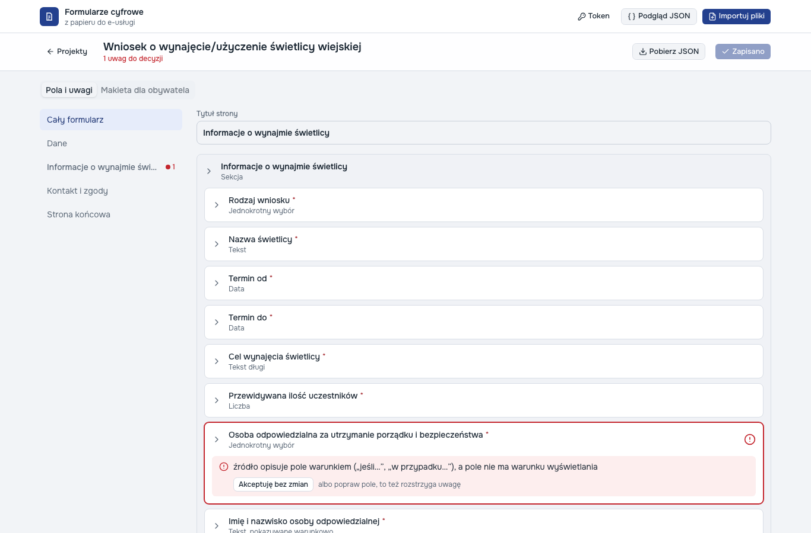
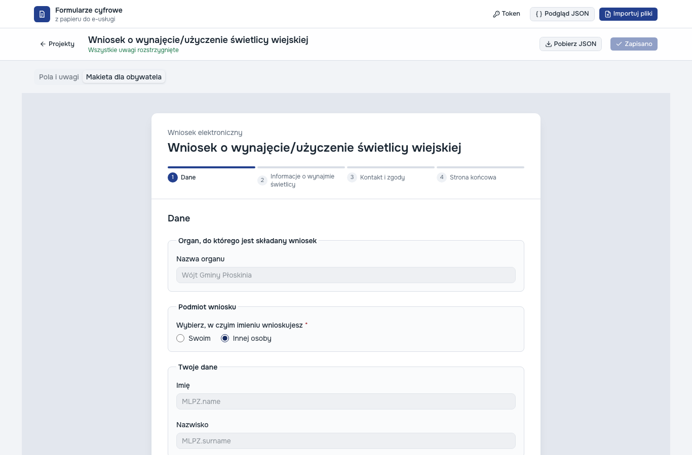

# Blankiet → e-usługa: formularz urzędowy w JSON COI w mniej niż minutę

**Podtytuł:** usługa REST, która zamienia jeden plik blankietu (PDF, DOC, DOCX, ODS, XLSX, JPG, PNG) na JSON gotowy do importu w Generatorze Formularzy COI. Do tego edytor, w którym urzędnik widzi, co sprawdzić.

## Problem

Urzędnik, który cyfryzuje e-usługę, ma papierowy wniosek: plik Worda, PDF albo skan. Musi go ręcznie przenieść do Generatora Formularzy: rozpisać strony, sekcje i pola, wybrać walidatory i słowniki, ustawić zależności („pokaż, jeśli zaznaczono…”) i pilnować Standardów COI. Formularz #9 (stypendium) to trzy wnioski w jednym i około 100 pól. Ręcznie to godziny pracy i spore ryzyko pomyłki.

## Rozwiązanie

Jedno wywołanie `POST /api/v1/forms` z plikiem zwraca JSON COI i raport. Przepływ: `parse → extract → generate → validate`.

1. **parse**: tekst wyciągamy lokalnie (Kreuzberg, Tesseract `pol`). Model wizyjny dostaje tylko te strony skanu, które odrzuci bramka jakości.
2. **extract**: LLM buduje `FieldTree`, czyli pola przedmiotu wniosku z kotwicą w źródle. Bramka (Pydantic i reguły z ocen eksperckich) odrzuca złe wyniki i uruchamia naprawę albo mocniejszy model.
3. **generate**: deterministycznie, bez LLM. Szablony stron „Dane”, „Kontakt i zgody” i strony końcowej według wzorców #1 i #5, słowniki z katalogu, walidatory z etykiet, `states` SHOW w JSONata.
4. **validate**: schemat JSON z zadania, reguły R1–R6, unikalne `techName`, poprawność odwołań JSONata.

Frontend „Formularze cyfrowe”:
- Import kilku plików naraz z postępem każdego etapu na żywo.
- Lista projektów.
- Edytor „Pola i uwagi” z czerwonymi znacznikami pól do decyzji („Akceptuję bez zmian” albo poprawka).
- „Makieta dla obywatela”: podgląd e-usługi z działającymi warunkami SHOW.
- Podgląd dowolnego JSON-a, pobieranie JSON-a, przyjmowanie proponowanych słowników.

Źródła: [README.md](../../README.md), [architecture.md](../architecture.md).

## Zakres minimalny i rozszerzenia

Pełna tabela z dowodami jest w [compliance.md](../compliance.md).

| Wymaganie | Jak spełniamy | Stan |
|---|---|---|
| M1: formaty PDF, DOC, DOCX, ODS, XLSX, JPG, JPEG, PNG | `coi/parsing/detect.py`: rozszerzenie i magic bytes muszą się zgadzać, inaczej 415 | ✅ |
| M2, M3: JSON zgodny z treścią, schematem i wzorcami #1, #5 | EVAL-5: wszystkie 33 wywołania (11 plików × 3) przechodzą `POST /forms/validate` i schemat. Wzorce #1 i #5 bez rozbieżności krytycznych | ✅ |
| M4: zasady projektowania (Standardy, Reguły techniczne) | Strony tematyczne z szablonów, pola domyślnie wymagane ([ADR 0018](../adr/0018-pola-domyslnie-wymagane.md)). Rozbieżności krytyczne w #1–#9 (EVAL-3 → EVAL-4 → EVAL-5): **22 → 12 → 12**, zob. „Jakość wyniku” | 🟡 |
| M5: dokumentacja architektury | [architecture.md](../architecture.md), 27 ADR-ów | ✅ |
| I: słowniki i dane inicjalne | Katalog słowników (Kraje, TERYT, województwa, powiaty, gminy, miejscowości), dopasowanie po etykiecie i opcjach, `defaultValue: "MLPZ.*"` | ✅ |
| II: propozycja nowego słownika | `report.proposed_dictionaries` (#5, #7, #9), przycisk „Przyjmij słownik” w edytorze (`POST /api/v1/dictionaries/from-proposal`) | ✅ |
| III: zależności i dynamiczne przepływy | EVAL-5: 382 warunki `states` SHOW w JSONata w wynikach, `$repeatingSectionIndex` w sekcjach powtarzalnych. Przejścia między stronami są liniowe, bo schemat nie ma warunków w `flow.links` | 🟡 |
| IV: frontend do wczytania i przeglądu | Import kilku plików, postęp na żywo, lista projektów, edytor, pobieranie JSON-a | ✅ |
| V: wizualizacja jako e-usługa | „Makieta dla obywatela” i „Podgląd JSON”: strony, sekcje, sekcje powtarzalne, słowniki, SHOW liczony przez `jsonata` | ✅ |
| VI: walidacje i UX | Walidatory z etykiet: REQUIRED, ZIP_CODE, EMAIL, NIP, REGON, PESEL, EPUAP, ADE, SERIAL_NUMBER_ID_CARD; import wsadowy; widok na tablecie. Brak walidatora telefonu (schemat zadania nie ma takiej nazwy) | 🟡 |

## Architektura w skrócie

- Dwa kontenery, każdy z własnym Dockerfile: `backend` (Flask/APIFlask, gunicorn, Python 3.14, Kreuzberg, Tesseract) i `frontend` (Vite, React, shadcn/ui, nginx bez roota). Wersje obrazów przypięte, procesy bez roota ([ADR 0003](../adr/0003-kontener-na-modul.md)).
- Jedno publiczne API REST, opis OpenAPI 3.1 i Swagger UI pod `/docs`. Błędy w formacie RFC 9457 ([ADR 0016](../adr/0016-bledy-rfc-9457-openapi-batch-we-froncie.md)).
- Dwa kontrakty między modułami: `ParsedDocument` (wynik parsera) i `FieldTree` (wynik ekstrakcji, wejście generatora). Generator nie zna numeru formularza; reguły wynikają z treści ([ADR 0024](../adr/0024-uniwersalne-reguly-bez-poprawek-pod-formularz.md)).
- Plik istnieje tylko w pamięci na czas żądania. W bazie zostaje wynik, nazwa i sha256 pliku ([storage.md](../storage.md)).
- 302 testy (`uv run pytest -m "not eden"`), bez sieci.

## Jakość wyniku (ocena ekspercka)

Każdy pomiar porównuje wynik z interpretacją papieru według Standardów COI, Reguł technicznych i wzorców #1 i #5 ([eval-5/README.md](../../results/eval-5/README.md)). Liczby dotyczą przebiegu mediany wersji edytowalnych #1–#9.

| Pomiar | Krytyczne | Średnie | Kosmetyczne |
|---|---|---|---|
| EVAL-3 | 22 | 32 | 31 |
| EVAL-4 | 12 | 21 | 33 |
| EVAL-5 | **12** | 21 | 37 |

Między EVAL-4 a EVAL-5 zniknęło 21 rozbieżności, a doszło 6 krytycznych, 11 średnich i 11 kosmetycznych. #3 i skan #7 nie mają już krytycznych. Krytyczne zostały w formularzach z osobami trzecimi i wieloma warunkami (#8: 5, #4: 2, #6: 2, #9: 2, #7: 1).

## Koszt i czas na formularz

EVAL-5: każdy z 11 plików przeszedł 3 razy, sekwencyjnie, na jednym kontenerze ([results/README.md](../../results/README.md), [eval-5/README.md](../../results/eval-5/README.md)). Czas to mediana z 3 przebiegów, pola i koszt dotyczą przebiegu mediany.

| Formularz | Format | Pola | Czas mediana [s] | Czas max [s] | Koszt [$] |
|---|---|---|---|---|---|
| #1 numer porządkowy (wzorzec) | docx | 54 | 10.0 | 13.8 | 0.0028 |
| #3 zaświadczenie | docx | 38 | 16.1 | 24.1 | 0.0037 |
| #6 pas drogowy | docx | 85 | 72.2 | 94.5 | 0.0142 |
| #8 deklaracja odpady | docx | 93 | **42.8** | 98.1 | 0.0670 |
| #9 stypendium (3 wnioski w 1) | docx | 100 | **39.7** | 43.2 | 0.0674 |
| #7 skan | jpg | 54 | 92.7 | 100.5 | 0.0162 |
| #9 skan | png | 99 | 98.6 | 107.4 | 0.0716 |

- #9 mieści się poniżej 60 s w 3 z 3 przebiegów, a #8 w 2 z 3. Dłuższy przebieg #8 (98 s) to drabina eskalacji: bramka odrzuciła wynik, więc były 4 rundy, ostatnie na większym modelu.
- Komplet 11 plików kosztuje **$0.27** (przebiegi mediany: $0.2660), średnio **2,4 centa** na formularz. #8, #9 i skan #9 dają około 75% kosztu.
- W trybie `LLM_PROVIDER=local` koszt API wynosi zero (płaci się tylko za GPU).

## Potencjał wdrożeniowy

- **Air gap:** `LLM_PROVIDER=local` i `LLM_BASE_URL` wskazujące Ollamę albo vLLM w sieci urzędu. Aplikacja nie wysyła wtedy nic na zewnątrz; sprawdza to test `tests/parsing/test_airgap.py` ([ADR 0010](../adr/0010-adapter-dostawcy-modeli-i-air-gap.md)). Parsowanie zawsze działa w kontenerze.
- **Logowanie urzędu:** backend tylko weryfikuje JWT. HS256 albo RS256 z kluczami z JWKS IdP, z kontrolą `iss`, `aud` i `exp` ([ADR 0015](../adr/0015-jwt-tylko-weryfikacja.md)).
- **Baza:** SQLAlchemy 2. SQLite na wolumenie albo PostgreSQL przez samą zmianę `DATABASE_URL` ([ADR 0017](../adr/0017-sqlite-za-sqlalchemy.md)).
- **Dostosowanie bez programisty:** prompty to pliki `.md` w `coi/prompts/`, które można podmontować jako wolumen. Drabiny modeli są w `ladder.json` i `EXTRACTION_LADDER`. Szablony stron i słowniki zmienia się bez wdrożenia ([architecture.md, Dostosowanie bez zmiany kodu](../architecture.md#dostosowanie-bez-zmiany-kodu)).
- **Integracja:** to samo API obsłuży front, system COI i agenta AI (np. AI HUB). SSE pokazuje postęp, a `?report=true` zwraca raport do przeglądu.

## Oryginalność

- **Drabina eskalacji z bramką jakości.** Najtańszy krok idzie pierwszy, a droższy model startuje tylko wtedy, gdy kod odrzuci wynik. Przy skanach Tesseract jest świadkiem: VLM, który „zmyśla” tekst, przegrywa porównanie pokrycia słów ([ADR 0008](../adr/0008-drabina-eskalacji-z-bramka.md), [ADR 0007](../adr/0007-t0-lokalnie-skany-do-vlm.md)).
- **Edytor z mapą źródła i `needs_review`.** Każde pole wie, z której strony i z którego bloku papieru pochodzi. Pola wątpliwe są oznaczone na czerwono z powodem („źródło opisuje pole warunkiem, a pole nie ma warunku wyświetlania”). Urzędnik akceptuje albo poprawia, a formularz przebudowuje się bez ponownego LLM (`/regenerate`, [ADR 0027](../adr/0027-tylko-osobiscie-i-regeneracja.md)).
- **Zero cichych porażek.** Każdy problem trafia do odpowiedzi: błąd RFC 9457, `warning`, `escalation` w SSE albo pozycja `needs_review`. Timeout modelu liczy się jako nieudany szczebel drabiny, a nie jako błąd żądania.
- **Słowniki tylko z dowodem.** Nowy słownik proponujemy tylko wtedy, gdy dokument daje listę pozycji, a JSON COI zawiera wyłącznie słowniki istniejące ([ADR 0021](../adr/0021-nowy-slownik-tylko-z-lista-pozycji.md), [ADR 0025](../adr/0025-propozycje-slownikow-tylko-w-raporcie.md)).

## Ograniczenia

- **Stabilność między przebiegami.** Ten sam plik w trzech przebiegach może dać różny wynik ([eval-5/zmiennosc.md](../../results/eval-5/zmiennosc.md)).
  - Bramka przeszła w 3 z 3 przebiegów tylko w #1.
  - W #8 dwa przebiegi gubią dwie sekcje papieru, które ma trzeci.
  - Około połowy krytycznych z mediany nie ma we wszystkich przebiegach. Inne przebiegi mają za to własne krytyczne.
  - Dziś głównym problemem jest stabilność, a nie brak reguł.
- **Jak to adresujemy:**
  - **Bramka:** wynik, który łamie regułę, nie przechodzi po cichu. Idzie do naprawy, potem do mocniejszego modelu.
  - **`needs_review`:** to, czego bramka nie rozstrzygnie, trafia do raportu z kotwicą w źródle.
  - **Edytor:** urzędnik widzi każdą uwagę na czerwono, akceptuje albo poprawia pole, a regeneracja nie woła modelu.
  - **Generator:** kolejne reguły przenosimy z promptu do deterministycznego generatora (T1, T2, T4, T6, T8, T9 w EVAL-5), więc model ma mniejszy wpływ na wynik.
- Żądanie jest synchroniczne. Skany trwają do około 110 s ([ADR 0013](../adr/0013-post-forms-synchronicznie.md)).
- Dokumenty biurowe nie mają obrazu strony, więc nie eskalują do VLM.
- Tryb air gap nie był uruchomiony end-to-end na prawdziwym modelu lokalnym dla pełnego zestawu ([compliance.md](../compliance.md), T3).
