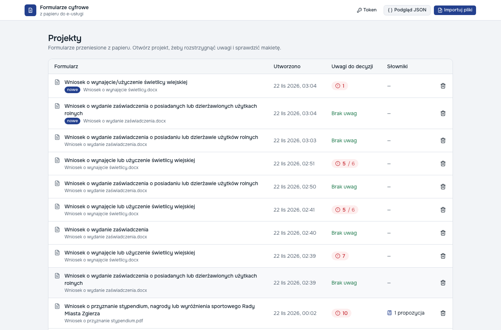
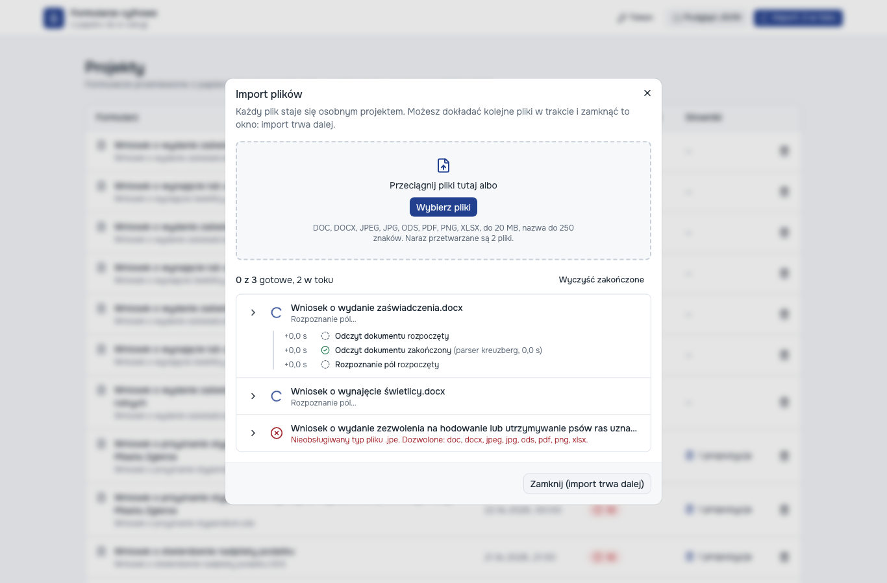
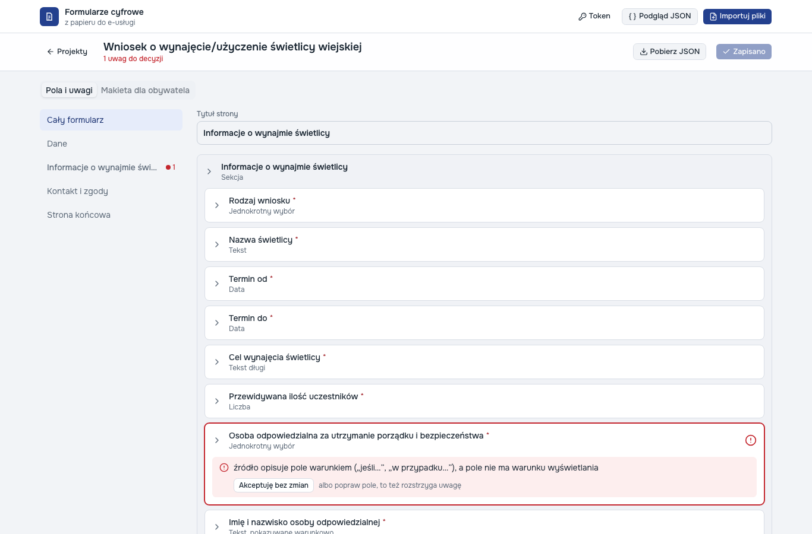
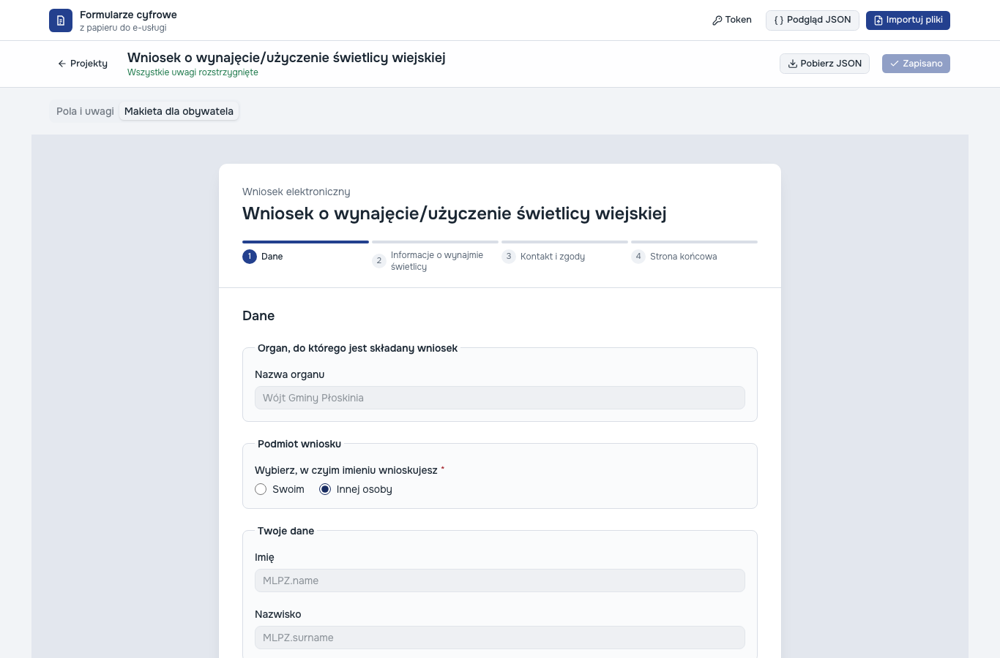
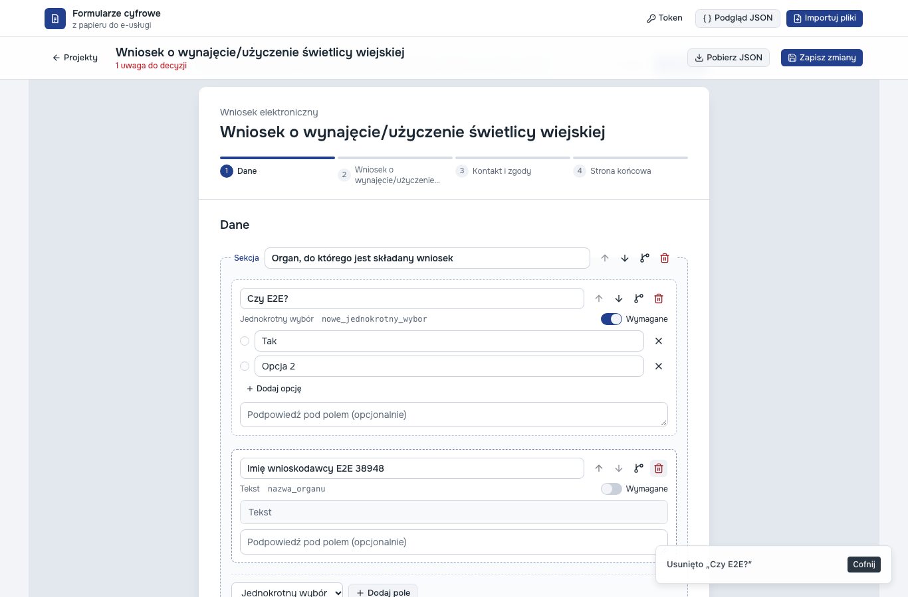
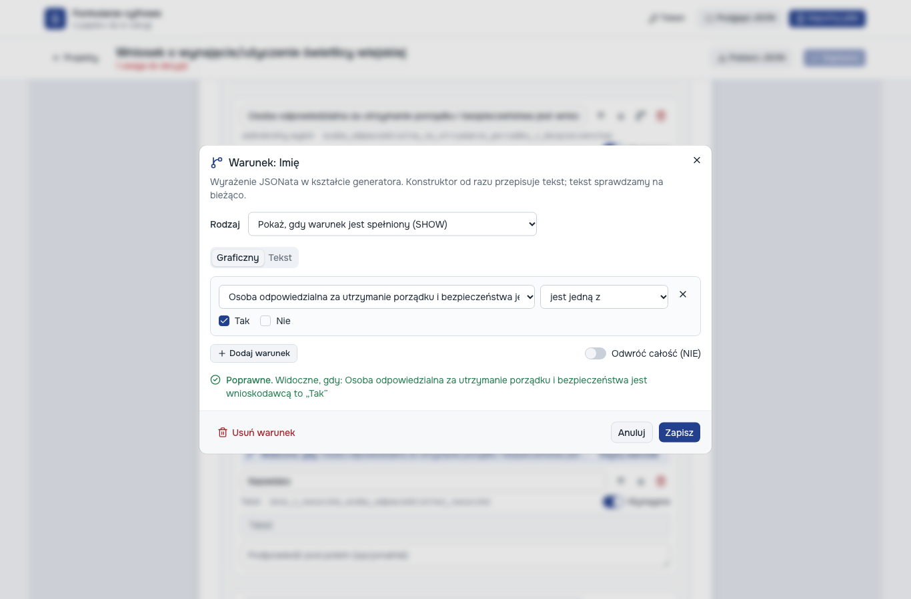

<!-- _class: hero -->
<!-- _paginate: false -->

# Blankiet → e-usługa

<p class="lead">Wrzucasz papierowy formularz, a w niecałą minutę dostajesz e-usługę gotową do importu w Generatorze Formularzy COI.</p>

---

# Problem

<div class="duo"><div>

- Urzędy trzymają **wnioski na papierze**: w Wordzie, PDF-ach i skanach
- Każdy trzeba **ręcznie** przepisać do Generatora Formularzy: strony, pola, walidatory, słowniki, warunki
- Formularz #9 (stypendium) to **trzy wnioski w jednym**

</div><div>


<p>Z nami: lista formularzy przeniesionych z papieru i liczba uwag do decyzji przy każdym</p>

</div></div>

---

# Rozwiązanie: jeden plik → JSON e-usługi

<div class="flow">
<div class="box"><b>📄</b>PDF · DOC(X) · ODS · XLSX · JPG · PNG</div>
<div class="arrow">→</div>
<div class="box"><b>parse</b>tekst lokalnie, OCR</div>
<div class="arrow">→</div>
<div class="box"><b>extract</b>LLM + bramka jakości</div>
<div class="arrow">→</div>
<div class="box"><b>generate</b>bez LLM, szablony COI</div>
<div class="arrow">→</div>
<div class="box"><b>validate</b>schemat + reguły</div>
<div class="arrow">→</div>
<div class="end">JSON COI<br/>+ raport</div>
</div>

<p class="lead" style="margin-top:40px">Jedno REST API, dwa kontenery Docker, frontend dla urzędnika.</p>

---

# Import i uwagi do decyzji

<div class="duo"><div>

### Import wielu plików w tle

<p>Wrzucasz kilka plików, zamykasz okno, a import trwa dalej z logiem każdego etapu.</p>

</div><div>

### Czerwone uwagi do decyzji

<p>Pole, którego bramka nie jest pewna, ma powód i przycisk „Akceptuję bez zmian”.</p>

</div></div>

---

# Makieta i edycja

<div class="duo"><div>

### Makieta dla obywatela

<p>E-usługa wygląda tak jak po imporcie, z działającymi warunkami pokazywania pól.</p>

</div><div>

### Edycja na makiecie

<p>Etykiety, opcje, wymagalność, dodawanie i usuwanie pól i sekcji z cofaniem.</p>

</div></div>

---

# Warunki i słowniki

<div class="duo"><div>

### Edytor warunków JSONata

<p>Konstruktor graficzny ⇄ tekst JSONata, sprawdzane na bieżąco i opisane słowami.</p>

</div><div>

### Słowniki i dane inicjalne

<p>Kraje, TERYT i gminy z katalogu, dane z profilu (<code>MLPZ.*</code>), nowy słownik jako propozycja.</p>

</div></div>

---

# Silnik i wdrożenie

<div class="duo"><div>

### Drabina modeli z bramką jakości
<div class="card">
<div class="step">Kreuzberg / Tesseract: lokalnie, 0 zł</div>
<div class="step gate">bramka jakości odrzuca? ↓</div>
<div class="step">mistral-small → naprawa</div>
<div class="step gate">nadal źle? ↓</div>
<div class="step">mistral-large → naprawa</div>
</div>
<p>Droższy model tylko wtedy, gdy kod odrzuci tańszy wynik: <b>~2,4 centa</b> na formularz, #9 w <b>~40 s</b>.</p>

</div><div>

### Air gap i prompty w plikach
<div class="card">

```bash
LLM_PROVIDER=local
LLM_BASE_URL=http://vllm.urzad:8000/v1
```

```text
coi/prompts/field_extraction.md
coi/prompts/vision_page.md
coi/parsing/ladder.json
```

</div>
<p>Lokalny model bez ruchu wychodzącego, a reguły urzędu dopisuje się w plikach <code>.md</code>.</p>

</div></div>

---

# Liczby

<div class="nums">
<div><span class="big">22 → 12</span>rozbieżności krytycznych<br/>EVAL-3 → EVAL-5</div>
<div><span class="big">33/33</span>poprawnych JSON-ów<br/>(11 plików × 3 przebiegi)</div>
<div><span class="big">~40 s</span>#9 stypendium<br/>(mediana)</div>
<div><span class="big">$0.27</span>komplet 11 formularzy</div>
</div>

<div class="src">Źródło: app/results/eval-5/README.md, app/results/README.md</div>

---

<!-- _class: hero -->
<!-- _paginate: false -->

# Chcesz zobaczyć?

<div class="mono">./run-them-all.sh</div>

<div class="links">
Frontend&nbsp;&nbsp;http://localhost:8080<br/>
Swagger&nbsp;&nbsp;&nbsp;http://localhost:8000/docs
</div>
