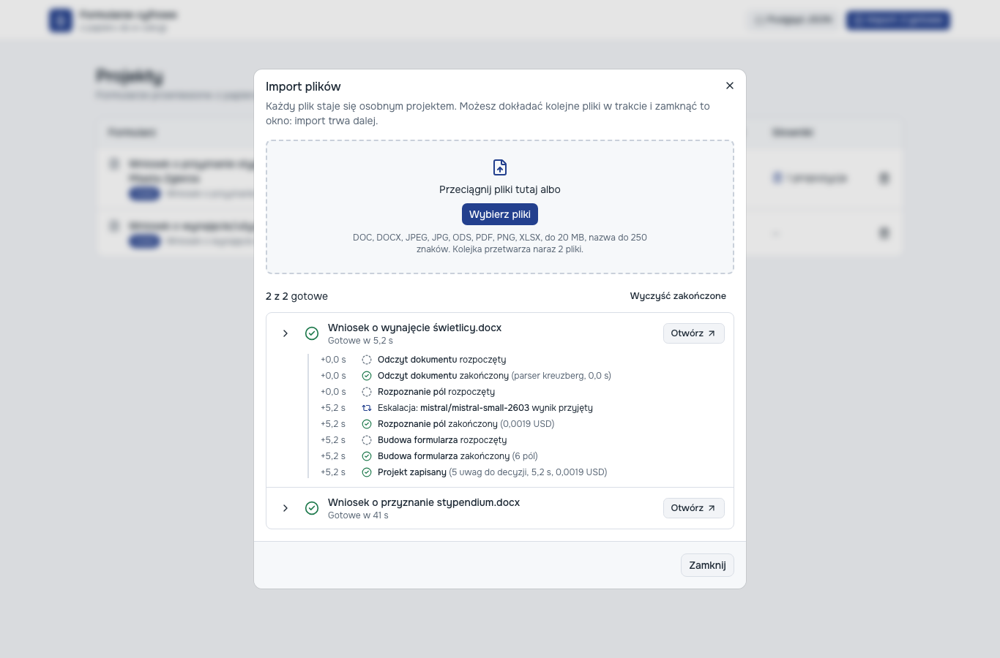
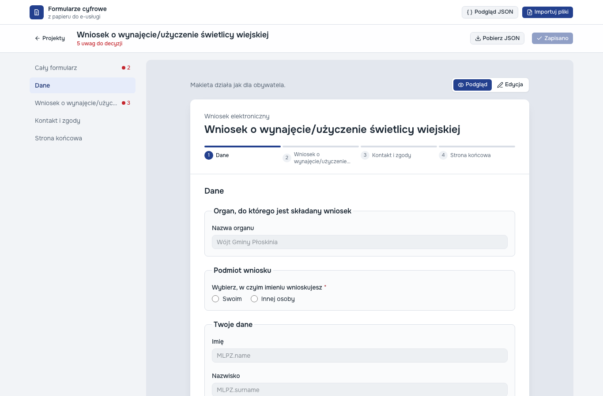
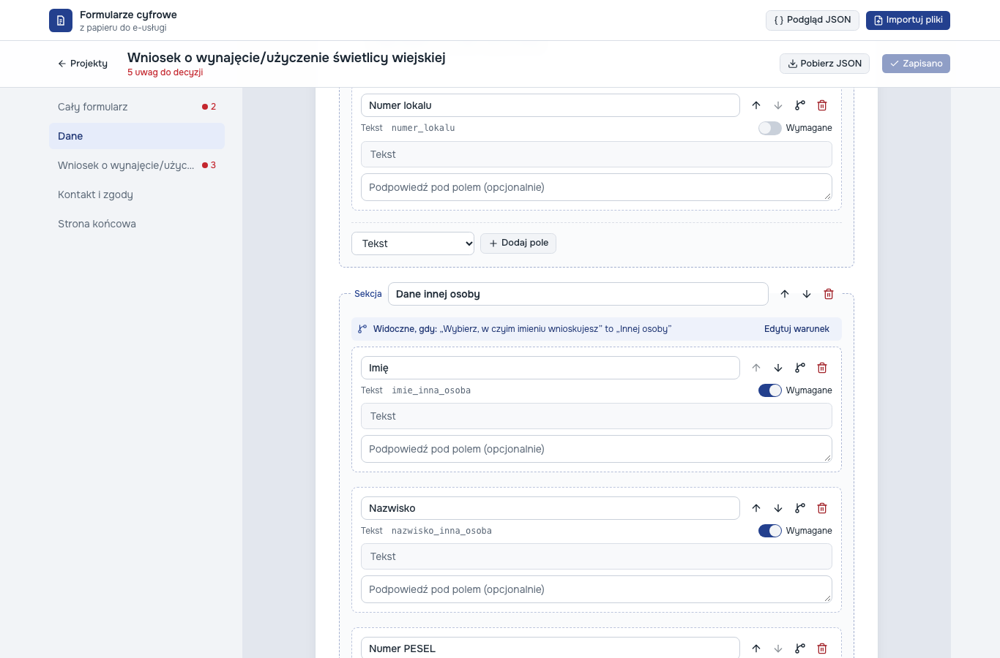
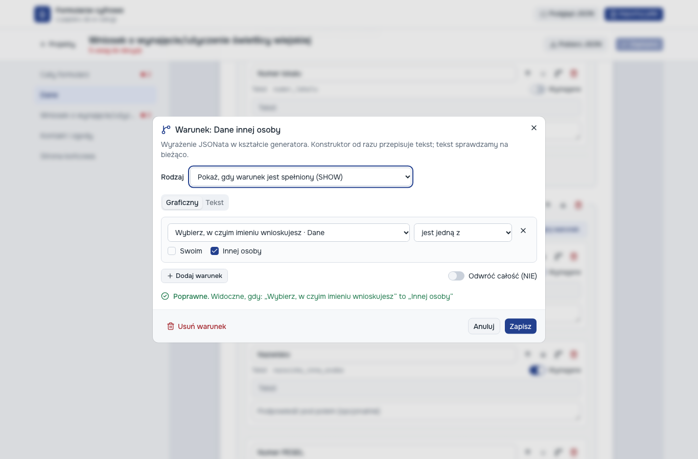

<!-- _class: hero -->
<!-- _paginate: false -->

# Blankiet → e-usługa

Urzędy przepisują papierowe wnioski do e-usług ręcznie, pole po polu. U nas wrzucasz plik i zwykle w niecałą minutę masz gotową e-usługę.

---

# Jak to działa

<b>📄</b>Word, PDF, Excel albo zdjęcie

→

<b>Czytamy</b>tekst na miejscu, bez wysyłania pliku

→

<b>Rozpoznajemy</b>pola wniosku z pomocą AI

→

<b>Budujemy</b>formularz według wzorców COI

→

<b>Sprawdzamy</b>z zasadami COI

→

Gotowa e-usługa

Urzędnik dostaje gotowy formularz i krótką listę rzeczy do sprawdzenia.

---

# Wrzucasz, sprawdzasz, oglądasz

<h3>Wiele plików naraz</h3>
Zamykasz okno, praca trwa dalej, każdy krok widać na liście.

<h3>Na czerwono to, co sprawdzić</h3>
Przy wątpliwym polu widać powód i co zrobić. Zostawiasz je albo poprawiasz.

<h3>Tak zobaczy to mieszkaniec</h3>
Pola pojawiają się po wyborze odpowiedzi, imię i nazwisko z profilu.

---

# Poprawiasz bez programisty

### Poprawki prosto w podglądzie

Zmieniasz nazwy, pola obowiązkowe i warunki, opisane zwykłym zdaniem. Dodajesz i usuwasz pola.

### Kiedy pokazać pole

„Pokaż, gdy wnioskujesz w imieniu innej osoby” ustawiasz kliknięciami. Kraje i gminy wybiera się z gotowych list.

---

# Szybko i tanio

- Tekst czytamy na miejscu, za darmo.
- AI tylko, gdy trzeba: najpierw mały, tani model, większy dopiero po pomyłce.
- Długi wniosek czytamy po stronach naraz: deklaracja śmieciowa z 3 min do 43 s.
- Pełny test (11 wniosków × 3) kosztował 81 centów.
- Może działać w sieci urzędu, bez wysyłania danych.

~10 grza formularz (2,4 centa)

$0.27za 11 formularzy

~40 sna duży wniosek

Źródło: app/results/eval-5/README.md ($0.2660, test $0.8071, czasy 42.8 s i 39.7 s), app/docs/architecture.md (#8 w EVAL-3: 184.5 s; drabina modeli). 1 USD ≈ 4 zł.

---

<!-- _class: hero -->
<!-- _paginate: false -->

# Chcesz zobaczyć?

./run-them-all.sh

Aplikacja&nbsp;&nbsp;&nbsp;&nbsp;&nbsp;&nbsp;http://localhost:8080 
Dokumentacja&nbsp;&nbsp;&nbsp;http://localhost:8000/docs

