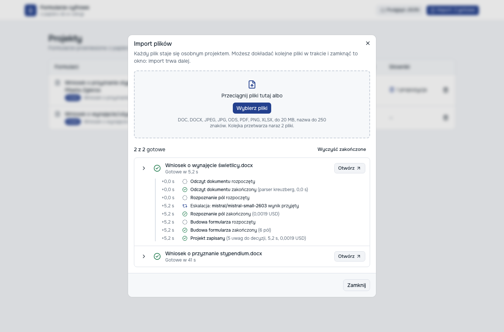
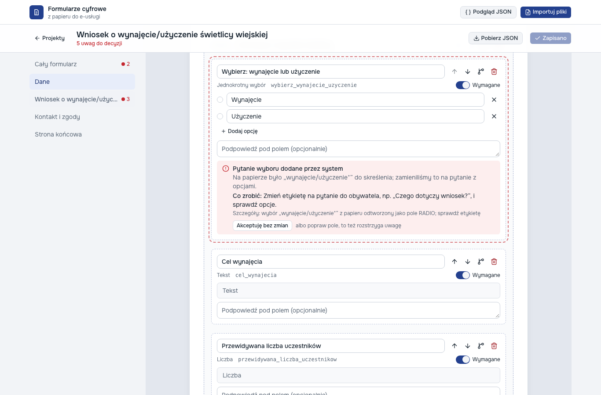
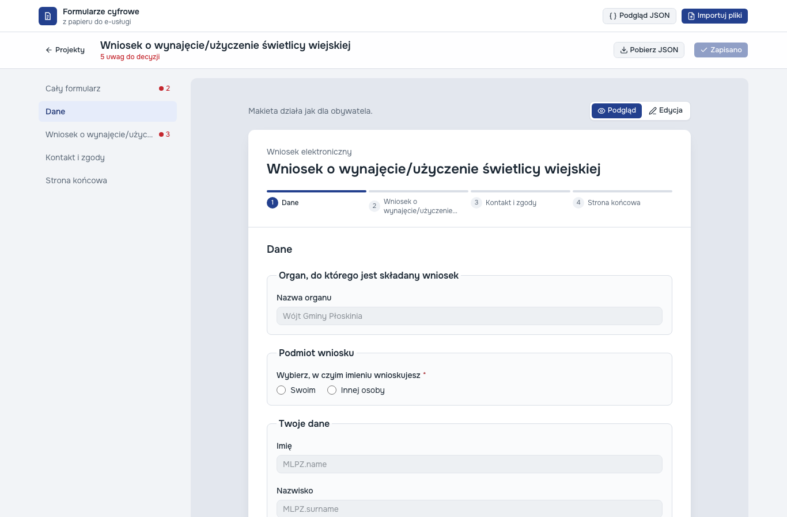

<!-- _paginate: false -->

# Blankiet → e-usługa

## Formularz urzędowy w JSON COI w mniej niż minutę

Jeden plik (PDF, DOC, DOCX, ODS, XLSX, JPG, PNG) → JSON gotowy do importu w Generatorze Formularzy COI

REST API · edytor z uwagami do decyzji · makieta dla obywatela · Docker · tryb air gap

---

# Problem

- Urzędnik przepisuje papierowy wniosek do Generatora Formularzy **ręcznie**: strony, sekcje, pola, walidatory, słowniki, warunki „pokaż, jeśli…”
- Formularz #9 (stypendium): **trzy wnioski w jednym**, około 100 pól
- Każda pomyłka to zła e-usługa dla mieszkańca, a Standardy COI trzeba znać na pamięć

**Cel:** plik blankietu na wejściu, poprawny JSON COI i lista rzeczy do sprawdzenia na wyjściu.

Źródło: materials/COI - Pełna treść zadania konkursowego.pdf; app/results/README.md (#9: 100 pól, EVAL-5)

---

# Architektura: parse → extract → generate → validate

<b>parse</b>Kreuzberg, Tesseract <code>pol</code> lokalnie. VLM tylko dla stron, które odrzuci bramka → <code>ParsedDocument</code>

→

<b>extract</b>LLM buduje pola z kotwicą w źródle. Bramka, naprawa, mocniejszy model → <code>FieldTree</code>

→

<b>generate</b>Deterministycznie, bez LLM: szablony stron, słowniki, walidatory, JSONata SHOW → JSON COI

→

<b>validate</b>Schemat zadania, reguły R1–R6, unikalne <code>techName</code>, odwołania JSONata

- 2 kontenery (backend Flask + gunicorn, frontend React + nginx), oba bez roota, wersje przypięte
- Jedno REST API: OpenAPI 3.1, Swagger `/docs`, błędy RFC 9457, postęp przez SSE
- Plik tylko w pamięci; w bazie zostaje wynik, nazwa i sha256 pliku

Źródło: app/docs/architecture.md, ADR 0003, 0013, 0014, 0016

---

# Koszt: ile i jak go zbiliśmy

1. **Tekst czytamy lokalnie, za darmo:** Kreuzberg (Word, PDF), Tesseract (skany), własny odczyt XML arkuszy
2. **Model tylko, gdy trzeba:** wołamy go dopiero wtedy, gdy kod odrzuci tańszy wynik
3. **Najpierw mały i tani model:** ministral-8b przy skanach, mistral-small przy polach; większy dopiero po porażce
4. **Długi wniosek po stronach, równolegle:** #8 ze 184.5 s (EVAL-3) do 42.8 s (EVAL-5, mediana)

$0.27 komplet 11 formularzy, ok. 2,4 centa na formularz

$0.81 pełny test EVAL-5: 11 plików × 3 przebiegi

Przy modelu w sieci urzędu (`LLM_PROVIDER=local`) koszt API wynosi zero, płaci się tylko za GPU.

Źródło: app/docs/architecture.md (Drabina eskalacji, Koszt na formularz), app/backend/coi/parsing/pipeline.py (sheet-xml), app/results/eval-5/README.md ($0.2660, $0.8071)

---

# Kompletność: minimum i rozszerzenia I–VI

| Wymaganie | Stan | Dowód |
|---|---|---|
| M1–M3: 8 formatów, JSON zgodny ze schematem i wzorcami | ✅ | 33/33 wywołań przechodzi walidację (EVAL-5) |
| M4: Standardy i Reguły techniczne | 🟡 | Rozb. krytyczne 22 → 12 → 12 (EVAL-3/4/5) |
| M5: dokumentacja | ✅ | architecture.md, 27 ADR-ów |
| I: słowniki i dane inicjalne | ✅ | Kraje, TERYT, gminy; `MLPZ.*` |
| II: propozycja słownika | ✅ | #5, #7, #9; „Przyjmij słownik” w edytorze |
| III: zależności | 🟡 | 382 warunki SHOW (JSONata); flow stron liniowy |
| IV, V: front i podgląd e-usługi | ✅ | import wsadowy, edytor, makieta ze SHOW |
| VI: walidatory i UX | 🟡 | PESEL, NIP, REGON, kod, e-mail, ePUAP…; brak telefonu |

Źródło: app/docs/compliance.md, app/results/eval-5/README.md, app/results/*.coi.json

---

# Intuicyjność: urzędnik widzi, co sprawdzić

<figure>Import kilku plików w tle, log etapów z czasem i kosztem</figure>
<figure>Uwaga do decyzji: powód, „Co zrobić” i „Akceptuję bez zmian”</figure>
<figure>Jeden edytor na makiecie: „Podgląd” działa jak e-usługa, „Edycja” zmienia pola</figure>

Po poprawce formularz przebudowuje się **bez ponownego LLM**. Zero cichych porażek.

Źródło: app/docs/submission/img/clean-*.png, ADR 0014, ADR 0027

---

# Wyniki EVAL-5: jakość, czas, koszt

22 → 12 → 12 rozbieżności krytyczne EVAL-3 / 4 / 5

$0.27 komplet 11 plików, średnio 2,4 centa na formularz

| Formularz | Pola | Czas mediana [s] | < 60 s | Koszt [$] |
|---|---|---|---|---|
| #1 wzorzec (docx) | 54 | 10.0 | 3/3 | 0.0028 |
| #3 zaświadczenie (docx) | 38 | 16.1 | 3/3 | 0.0037 |
| #6 pas drogowy (docx) | 85 | 72.2 | 1/3 | 0.0142 |
| #8 odpady (docx) | 93 | **42.8** | 2/3 | 0.0670 |
| #9 stypendium (docx) | 100 | **39.7** | 3/3 | 0.0674 |
| #7 skan (jpg) | 54 | 92.7 | 0/3 | 0.0162 |
| #9 skan (png) | 99 | 98.6 | 0/3 | 0.0716 |

3 przebiegi na plik, sekwencyjnie. Pola i koszt z przebiegu mediany.

Źródło: app/results/eval-5/README.md, app/results/eval-5/zmiennosc.md, app/results/README.md

---

# Jakość kodu i uczciwe ograniczenie

- Dwa kontrakty: `ParsedDocument` i `FieldTree`
- Generator deterministyczny, **nie zna numeru formularza**
- **302 testy** bez sieci, test trybu air gap
- **27 ADR-ów**: Standardy COI > wzorce #1/#5 > ADR
- Python 3.14, licencje bez copyleftu
- Oceny eksperckie EVAL-3…5, reguły posortowane po zysku

**Stabilność między przebiegami.** Bramka przeszła 3/3 tylko w #1. W #8 dwa z trzech przebiegów gubią dwie sekcje papieru.

**Jak to adresujemy:** bramka nie przepuszcza złego wyniku po cichu, `needs_review` wskazuje miejsce w źródle, edytor daje decyzję urzędnikowi, a kolejne reguły przechodzą z promptu do deterministycznego generatora.

Źródło: app/results/eval-5/README.md (Zmienność), app/docs/adr/, pytest -m "not eden"

---

# Potencjał wdrożeniowy

- **Air gap:** `LLM_PROVIDER=local` + Ollama / vLLM w sieci urzędu, zero ruchu wychodzącego
- **IdP urzędu:** JWT RS256 z JWKS, kontrola `iss`, `aud`, `exp`
- **Baza:** SQLite albo PostgreSQL przez `DATABASE_URL` (SQLAlchemy)

- **Prompty w plikach `.md`**: urząd dopisuje własne reguły bez programisty
- **Drabina modeli w konfiguracji**: `ladder.json`, `EXTRACTION_LADDER`
- **Jedno API** dla frontu, systemu COI i agentów AI

**Koszt:** średnio 2,4 centa na formularz w chmurze, $0 API w trybie lokalnym (tylko GPU).

Źródło: app/README.md (Konfiguracja, Tryb air gap), ADR 0010, 0015, 0017; koszt: app/results/README.md

---

<!-- _paginate: false -->

# Blankiet → e-usługa

- Minimum i rozszerzenia I–VI (III i VI częściowo, z ograniczeniami schematu)
- #9 w 40 s, #8 w 43 s (mediana); komplet 11 plików za $0.27
- Drabina eskalacji: droższy model tylko wtedy, gdy kod odrzuci tańszy wynik
- Edytor z uwagami do decyzji i regeneracją bez LLM
- Gotowe do air gap i logowania przez IdP urzędu

**Kod:** `app/` · **Swagger:** `/docs` · **Wyniki i oceny:** `app/results/`
